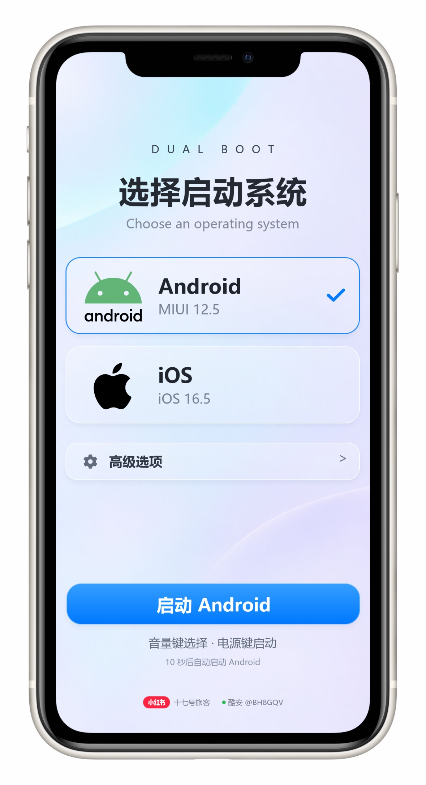

# Hercules Mi8 Dual-Boot Lab

小米 8（`dipper`）双系统引导界面、构建工具与设备实验记录。

本项目基于 [dipper-xnu](https://github.com/youzjuzi/dipper-xnu)、SimpleInit 与 edk2-sdm845 的已有工作，整理本机完成的引导界面和验证结果。iOS 内核及驱动移植的主要上游贡献不属于本项目原创。

## 下载

[公开固件组件与对应源码](https://github.com/Hercules-Zhaoziyi/mi8-dualboot-lab/releases)

Release 提供 AArch64 UI 应用 `HerculesBootMenu.efi`、同 GUID 的 `.ffs` 固件文件、Android 交接组件、源码包和 SHA256 校验文件。它们用于集成到自备、兼容的 UEFI 环境。

完整手机 `boot.img`、XNU/iOS 载荷、IPSW、APFS/root/cryptex 镜像、Apple 私有库、应用 IPA、设备存档和 Windows 字库不随仓库分发。**EFI/FFS 组件不能直接用作手机 boot 分区镜像。** 请先阅读 [安装与集成](docs/INSTALL.md)。

## 界面

- 保留定稿的浅色壁纸、玻璃卡片、布局和三个指定 SVG 标志。
- 标题、英文、版本号、按钮、提示与署名均为真实 LVGL 文字控件。
- 主标题略微缩小；首页、高级选项和子菜单共用文字署名，两个账号组以留白分隔。
- 音量键移动，短按电源确认；触控可选择系统并使用启动按钮。
- 无操作 10 秒自动启动 Android。首次按键或触控取消本次开机的计时；返回首页不会恢复计时。
- 选中高级选项时清除系统卡片勾选和蓝框，底部按钮同步执行高级选项。返回后恢复原系统选择。
- SVG 按真实固件的 2 倍采样处理，使用固定容器与包含式缩放，避免覆盖文字或裁切。

三个 SVG **原件原样保留**在 [assets/logos](assets/logos)。固件用派生副本仅归一化视口尺寸，路径、填充和图形不变。

### 同款文字字库

不会将替换字体版冒充定稿同款。公开组件通过两个 RAW FFS 资源加载用户在本机准备的同款字库，资源未就绪时进入手动维护提示，不偷偷改用其他字形或自动启动。字库软件不上传；本机制作方法见 [字库资源](docs/FONTS.md)。手机已安装的版本不因公开构建而改变。

## 项目资料

| 内容 | 入口 |
| --- | --- |
| 日常操作 | [USAGE](docs/USAGE.md) |
| 安装、备份与回退 | [INSTALL](docs/INSTALL.md) |
| 编译与固件文件 | [BUILD](docs/BUILD.md) |
| 同款本地字库包 | [FONTS](docs/FONTS.md) |
| 验证范围 | [VALIDATION](docs/VALIDATION.md) |
| 功能和限制 | [STATUS](docs/STATUS.md) |
| 开发过程和问题定位 | [HISTORY](docs/HISTORY.md) |
| 存储与对半分区问题 | [STORAGE](docs/STORAGE.md) |
| 网络、蓝牙和应用实验 | [EXPERIMENTS](docs/EXPERIMENTS.md) |
| 发布范围与附件清单 | [PUBLICATION](docs/PUBLICATION.md) |
| 第三方归属 | [THIRD_PARTY_NOTICES](THIRD_PARTY_NOTICES.md) |

## 验证边界

维护者使用的小米 8 为 8 GB / 128 GB，原 Android 为 MIUI 12.5.2 / Android 10。主机构建在 Windows 11 + WSL Ubuntu 完成。已实机验证的本机整合版本保留 Android、iOS、照片、设置和两个测试应用，完整 boot 写入后回读一致；维护者随后报告测试正常。

公开组件新增了不分发私有字库的数据提供层，已完成模块构建、真实 LVGL/FreeType/SVG 和内存回归；**该公开封装未重新刷机实测**。不以主机预览替代完整设备回归。

本项目没有实现 Android/iOS 各约 60 GB 的可写存储，也没有修复 iOS 滑动关机卡圈。完整音频、相机、电话等仍受上游移植限制，详见 [STATUS](docs/STATUS.md)。

## 归属

署名：小红书「十七号旅客」　酷安 `@BH8GQV`。

本项目与 Apple、小米、酷安或小红书不存在官方隶属关系。标志和商标属于各自权利人。源码、文档、字体及依赖分别遵循各自许可证，见 [LICENSE](LICENSE.md)。

固件卷集成还需 `HerculesBootConfig.ffs`（GUID `4b0364cf-1c5b-47aa-9073-d7b5039ce49b`）；它封装公开的 `simpleinit.static.uefi.cfg`，用于启用同款界面、10 秒默认 Android 和两个入口。单独复制 UI 应用不会自动加载这些配置。

## Agent 复刻与其他机型

从 [AGENTS.md](AGENTS.md) 开始，阅读 [AI agent 协议](docs/AGENT-REPRODUCTION.md)、[从源码到 iOS 刷入](docs/IOS-REPRODUCTION.md) 与 [跨机型适配](docs/PORTING.md)。提供固定上游获取工具、阶段证据模板和通用菜单目标配置生成器。通用化适用于 UI 与适配方法，不表示所有手机均可运行 iOS。旧 Release 仍是 Mi8 组件；新增通用源码需重建，其他设备未验证。

## Windows 安装维护向导（开发预览）

[Mi8 Install Desk](installer/README.md) 提供图形化设备核验、校验下载、TWRP 临时启动、备份和 boot/recovery 写入回读。当前不包含首次重分区及完整系统构建的一键自动化；未做全新电脑/第二台设备端到端验收。不要将其当作完整一键 iOS 安装器。
